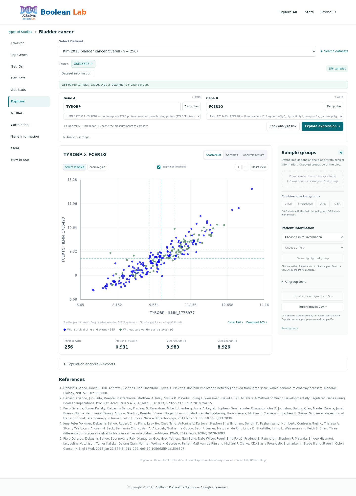

# Hegemon

**HIERARCHICAL EXPLORATION OF GENE EXPRESSION MICROARRAYS ONLINE FOR ANALYZING AND VISUALIZING BIOLOGICAL DATASETS**

Hegemon helps researchers compare genes, discover Boolean relationships, select sample populations, and investigate clinical and survival outcomes. This repository contains the updated Boolean Lab interface and legacy-compatible scientific tools, derived from [sahoo00/Hegemon](https://github.com/sahoo00/Hegemon).



[User manual](manual.html) · [Dataset configuration](#dataset-configuration) · [Testing](#testing) · [Security](SECURITY.md)

## Choose a Branch

| Branch | Purpose | Runtime |
| --- | --- | --- |
| **`main`** | Updated interface running on the native legacy-compatible stack, including the deployed optimizations to handle large datasets | Apache/PHP 7.2, Java 8, Python 2.7, R and LaTeX |
| [`modern-stack`](https://github.com/amitashnanda/Hegemon/tree/modern-stack) | Separately maintained updated-stack application with the same structured layout | PHP 8.4, Java 21, Python 3, R and LaTeX in Apptainer |

The modern branch is based on the separately maintained Hegemon 2.0 source, not an automatic conversion of this branch. Features and performance fixes must be compared before merging. See [branch/publication guidance](doc/PUBLISHING.md).

## Features

- Browse study categories and search datasets, accession IDs, gene symbols, and probe IDs.
- Explore expression using interactive scatterplots, sample hover, mouse/keyboard zoom, pan, and rectangular selection.
- Render large populations with a canvas point layer and paginated sample tables, without subsampling.
- Highlight patient information; create, rename, combine, intersect, subtract, and export sample groups.
- Run MiDReG/Boolean, correlation, differential, population-summary, and survival analyses when their data requirements are met.
- Export CSV, survival R code, scientific PNG/JPEG/SVG/PDF figures, and combined PDF reports.
- Open the illustrated **How to use** manual from the workspace.

## Requirements

This branch targets **Linux with native Apache/PHP**. A Mac can access a Linux preview through SSH; the supplied Apache launcher is not a native macOS/Windows installer.

| Component | Reference stack tested in the source installation |
| --- | --- |
| Apache / PHP | Apache 2.4.29; PHP 7.2.24 with the Apache PHP module |
| PHP extensions | GD, JSON, ctype, POSIX; scientific process execution must be permitted |
| Java | JDK 8; the source installation used Oracle 8 update 45 |
| Python | 2.7.17; NumPy 1.13.3, SciPy 0.19.1, Matplotlib 2.1.1, pandas 0.22.0, Pillow 5.1.0, bitarray 0.8.1 |
| R | 4.4.1 with `survival` 3.7.0; `ggplot2` optional because a base-R violin fallback is included |
| PDF reports | TeX Live 2017 / pdfTeX 1.40.18 |
| Browser | Modern JavaScript/SVG/canvas support |

No GPU, npm build, SQL database, application container, or Java web server is needed. Perl is not required by the current web-analysis routes. Java, Python, R, and LaTeX are helper processes launched by PHP.

> These historical interpreter versions are obsolete. Compatibility is not a security endorsement. Do not replace default system interpreters or install obsolete packages system-wide. Use an approved existing environment, or consider the isolated modern branch. Public deployment needs an administrator's review.

## Run Locally

### 1. Obtain this branch

```bash
git clone --branch main https://github.com/amitashnanda/Hegemon.git
cd Hegemon
```

These commands apply after the prepared branches have been published. If you already have this checkout, simply enter its root.

### 2. Supply your private dataset registry

```bash
test -f explore.conf || cp config/explore.conf.example explore.conf
```

Edit `explore.conf` so its paths point to your approved processed files. It is deliberately ignored by Git. **Data are not included or downloaded automatically**; a registry alone is insufficient.

### 3. Configure your approved runtime paths

Defaults use `java`, `python2.7`, `R`, and `pdflatex` from the environment's PATH. If needed:

```bash
test -f config/localstack.local.php || cp config/localstack.example.php config/localstack.local.php
```

Edit the placeholder paths in the ignored local file. Nonempty `HEGEMON_CONFIG`, `HEGEMON_JAVA`, `HEGEMON_PYTHON`, `HEGEMON_R`, and `HEGEMON_PDFLATEX` environment values take precedence over configuration defaults. Do not commit host-specific overrides.

The preview's default module layout is Ubuntu's `/usr/lib/apache2/modules`, including `libphp7.2.so`. On a different approved Linux layout, set `HEGEMON_APACHE_BIN`, `HEGEMON_APACHE_ROOT`, `HEGEMON_APACHE_MODULE_DIR`, `HEGEMON_APACHE_PHP_MODULE`, and/or `HEGEMON_MIME_TYPES` as appropriate. No system Apache configuration is modified.

### 4. Check and launch

```bash
bash scripts/check-stack.sh
HEGEMON_PORT=8092 bash scripts/run-local.sh
```

Open **http://127.0.0.1:8092/Hegemon/index.html** on that machine. The launcher recompiles ignored Java classes using the selected JDK, then starts a separate, unprivileged **loopback-only Apache/PHP preview**. Keep the terminal open; **Ctrl-C stops only this preview**, not the existing system web service.

Both `tmpdir/` and `runtime/` must be writable by the preview account. Runtime configuration, PID, and logs are generated under `runtime/main/port-8092/`. To choose another port, change `HEGEMON_PORT`; to select another registry, set `HEGEMON_CONFIG=/absolute/path/to/explore.conf`.

### 5. Optional: open the remote preview from a Mac

In a second Mac terminal, replace the SSH destination with your own:

```bash
ssh -N -o ExitOnForwardFailure=yes \
  -L 127.0.0.1:19092:127.0.0.1:8092 YOUR_USER@YOUR_SERVER
```

Open **http://127.0.0.1:19092/Hegemon/index.html** on the Mac. `19092` is the Mac port; `8092` is the remote preview port. If a local port is busy, check it with `lsof -nP -iTCP:19092 -sTCP:LISTEN` and choose another local port. Keep both the preview and SSH terminals open.

## Dataset Configuration

Root `explore.conf` is the default registry. Each section registers an ID, display name, processed-file paths, study/category key, and source. The example template uses Kim 2010 bladder cancer (`B2.1`, GEO `GSE13507`) with **placeholder paths**.

| Field/file | Role |
| --- | --- |
| `expr` / `*-expr.txt` | Probe-by-sample expression matrix; required |
| `index` / `*-idx.txt` | Probe annotations and byte offsets into the exact expression matrix; required |
| `survival` | Sample-linked outcomes and/or patient information for the corresponding features |
| `indexHeader` / `*-ih.txt` | Supplementary sample/header annotations for legacy-compatible exports |
| `info` / `*-info.txt` | Probe-level information used by ranking and related tools |
| `*-thr.txt` | Stored StepMiner thresholds |
| `*-bv.txt` | Precomputed Boolean vectors used by Boolean/genome-wide tools |

Threshold and Boolean-vector companions may be inferred from the registered dataset prefix even without separate registry lines. Keep matching files together. The registry does not contain expression values or grant access to restricted directories. The actual web/preview account must be able to traverse and read the approved paths.

Changes are read on subsequent requests; refresh an open page to reload its catalogue. No rebuild is required. Dataset source accessions/URLs appear as provenance links. Category keys filter discovery, not filesystem permissions or authentication.

### First analysis with Kim 2010

1. Open **Bladder cancer → View**, or search for `B2.1` / `GSE13507`.
2. Select **Kim 2010 bladder cancer Overall** and inspect its source information.
3. Keep **TYROBP** and **FCER1G**, click **Find probes**, then **Explore expressions**. Dataset selection alone does not draw a plot.
4. Hover/zoom/pan, or choose **Select samples** and draw a rectangle to create a population.
5. Highlight patient-information values and compare groups using set operations or population analysis.
6. Export results; survival needs eligible outcomes, and PDF generation needs writable runtime storage plus the scientific/PDF dependencies.

Gene A is on the x-axis; Gene B is on the y-axis. Default blue/green colors distinguish samples with/without eligible survival metadata; they are not biological classes. Open **How to use** for the complete illustrated workflow.

## Project Structure

```text
Hegemon/
├── index.html, workspace.html, manual.html  Public pages
├── api.php, explore.php, stats.php         Stable entrypoints
├── app/                                   PHP implementation and scientific/data libraries
├── config/                                Public templates and ignored local overrides
├── assets/                                CSS, JavaScript, images, vendor libraries, tutorial assets
├── Images/.htaccess                       Old image-URL redirects only
├── scripts/                               Native launch/build/check/test helpers; Python/R helpers
├── tools/                                 Java source; compiled classes are ignored
├── tmpdir/                                Ignored generated figures/reports/caches
├── runtime/                               Ignored private preview/test state
├── tests/                                 Portable packaging/API/browser checks
├── doc/                                   Architecture, preparation and publication notes
└── explore.conf                           Private registry; intentionally untracked
```

Keep `tools/` and `tmpdir/` at the root. Old asset URLs redirect to the structured assets; public entry filenames and dataset/gene URL parameters are preserved.

## Testing

With a private preview running and Kim data configured:

```bash
python3 tests/test_packaging.py
python3 tests/smoke.py --base-url http://127.0.0.1:8092/Hegemon/ --render
```

The API smoke test checks routing protection, gene lookup, complete sample counts, group summaries, CSV, clinical alignment, and optional PNG/box/violin/PDF/survival generation. Select another dataset with `--dataset`, `--gene-a`, and `--gene-b`. These are actual-data tests, not a claim that every registered dataset has been validated.

Optional browser checks need a separate Python 3 environment with Playwright and a Chromium installation:

```bash
HEGEMON_TEST_PYTHON=/path/to/test-environment/bin/python \
HEGEMON_TEST_BASE_URL=http://127.0.0.1:8092/Hegemon/ bash scripts/test-browser.sh
```

Set `HEGEMON_CHROMIUM` for an existing Chromium executable, or install Playwright's browser into that test environment. Python 3/Playwright are test tools only; the application remains on Python 2.7.

## Security and Publication

Read [SECURITY.md](SECURITY.md) before sharing or deploying. Real registries, raw datasets, credentials, private overrides, runtime outputs, logs, Java classes, SIF/OCI images, and old validation archives are excluded. The three GSE13507 tutorial downloads under `assets/manual/` are explicitly identified public examples, not an allowance to upload other sample data. Analytics is disabled in this public source copy.

`.gitignore` does not remove already committed secrets. Review staged/history contents before pushing. Public Apache must enforce `.htaccess` or equivalent restrictions, and only output/cache directories should need web-account write access. Testing under your username does not prove production's web account has equal permissions. A private preview is not a production installation procedure.

## Documentation

- [Illustrated user manual](manual.html) — open through the running website for the HTML guide.
- [Architecture and processed files](doc/ARCHITECTURE.md).
- [Repository preparation and exclusions](doc/REPOSITORY_PREPARATION.md).
- [Branch and publication instructions](doc/PUBLISHING.md).

Preview errors are recorded under `runtime/main/port-PORT/`; scientific outputs stay under ignored `tmpdir/`. For missing datasets, check the actual registry and account access. For failed reports, check configured binaries, packages, and output permissions. Do not publish logs or registry contents without review.

## Acknowledgements

- **Original software and research framework:** Boolean Lab, led by **Debashis Sahoo**, University of California San Diego, for developing Hegemon and its scientific analysis framework.
- **Upstream source code:** [sahoo00/Hegemon](https://github.com/sahoo00/Hegemon), the original codebase on which this updated application is based.
- **Contributor:** [Amitash Nanda](https://github.com/amitashnanda), for contributions to the updated interface, backend integration, performance improvements, runtime packaging, and documentation.

## License

See [LICENSE](LICENSE) for GNU GPL version 3 and bundled vendor notices for third-party terms. Dataset use and attribution remain subject to each original provider's terms.
